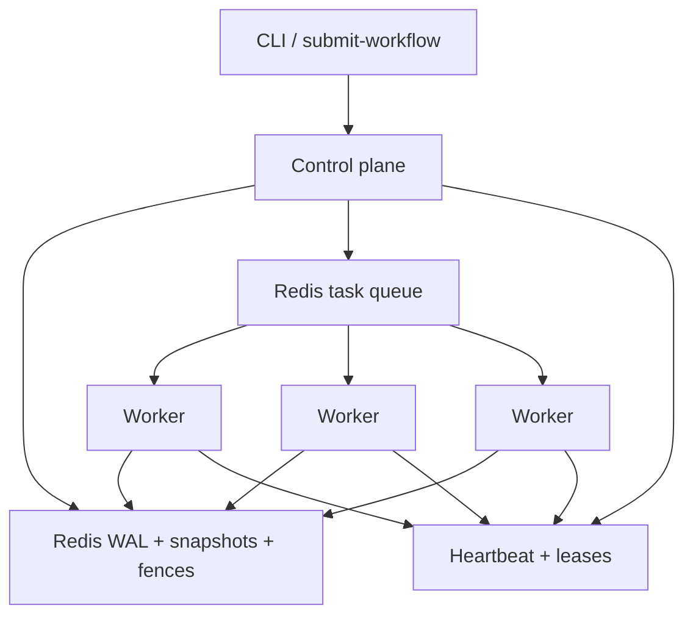

# Aether

[](https://github.com/andrey-tretyak/project-aether/actions/workflows/ci.yml)

**Fault-tolerant orchestration for multi-agent DAGs.** Workers can die mid-step; state cannot.

Aether runs agent workflows as a directed acyclic graph across a local Docker cluster. It is built for the failure mode that breaks most “just queue the LLM calls” systems: a worker disappears while holding a tool result, then comes back and tries to write it after the task has already been given to someone else.

```
Submit DAG  →  Control plane schedules ready tasks
            →  Workers claim with a fence token
            →  Results append to a Redis WAL
            →  Crash → snapshot + replay, never re-prompt
```

| Constraint | Choice |
| --- | --- |
| Budget | Local Docker only. No cloud, no LLM API spend. |
| Execution | At-least-once (retries after crash are required). |
| State | Fence-monotonic commits. Stale writers are rejected. |
| Recovery | Heartbeat every 500ms from a dedicated thread; 1.5s lease; a killed worker's task is finished elsewhere in ~2s. |
| Control plane | One leader, hot standbys. A standby takes over ~2s after the leader dies; a deposed leader cannot write. |
| Replay | Cached WAL outputs. Non-deterministic models are not re-invoked. |

---

## Why this exists

Agent graphs are not ordinary jobs. Steps are **non-deterministic**, context is **expensive to rebuild**, and a late write from a partitioned worker can silently corrupt the next prompt.

Aether treats that as a distributed-systems problem:

1. **Log first.** Every dispatch, claim, result, and reassignment is an append-only delta in Redis (`aether:wal:{workflow_id}`), with periodic snapshots.
2. **Fence every assignment.** Reassigning a task increments a per-task fence. The WAL refuses any commit whose token is behind the current value — the zombie-writer case.
3. **Fail cheaply.** The worker runtime talks to a deterministic mock agent (100–500ms synthetic latency). Chaos tests do not depend on OpenAI, GPUs, or a bill.

This is the same shape as production orchestrators (Temporal-style workflows, Kafka-style log + snapshot, Redlock-style short leases) cut down to a cluster you can `docker kill` on a laptop.

---

## Architecture



| Component | Role |
| --- | --- |
| **Scheduler** | The only dispatcher. Resolves the DAG, dispatches tasks whose dependencies are `COMPLETED`, requeues work owned by a dead worker. |
| **WAL** | Append-only deltas, snapshot, replay from `wal_index`. Source of truth after crash. |
| **Heartbeat monitor** | Redis hash + TTL leases. Missed liveness → `on_worker_failure`. |
| **Leader election** | One Redis lease key holding `node:epoch`. Standbys campaign; every control-plane write checks the token in the same transaction. |
| **Worker executor** | `BRPOP` the queue, `SET NX` a lock, refresh TTL while running, commit through the WAL, publish a wake-up. Heartbeats from its own thread; drains on `SIGTERM`. |
| **Mock agent** | Hash-seeded delay and JSON. Swap point for Ollama / vLLM later. |

Control plane and workers are separate processes (`python -m src.main control-plane` / `worker`). Run as many control planes as you like; one leads and the rest stand by. One Redis instance is the coordination fabric so the Compose file stays three services, not a message-bus zoo.

---

## Correctness model

Managers usually ask three questions. The answers are in the code, not the pitch.

**What happens if a worker is killed mid-task?**  
The lease expires (1.5s). The control plane bumps the fence, sets the task back to `PENDING`, deletes the lock, and puts it at the *front* of the queue, so recovered work does not wait behind the backlog. Remaining workers finish the DAG.

**What if a task keeps killing its workers?**  
Each reassignment counts as a retry. After 3, the task is marked `FAILED` (with the reason in the WAL) and the workflow stops, instead of a poison task taking down the whole fleet one worker at a time.

**What happens if the dead worker wakes up and writes?**  
`WriteAheadLog.append_delta` compares the commit’s `fence_token` to `aether:fence:{task_id}`. A higher fence → `StaleFenceError`. The late write never lands. The chaos test does exactly this with real processes: it freezes a busy worker with `SIGSTOP`, waits until the control plane has declared it dead and reassigned its task, then resumes it with `SIGCONT` and requires its write to be rejected and the task committed once, under the new fence. The resumed worker then rejoins and picks up new work.

**Do we re-call the model on recovery?**  
No. `recover_latest_state` loads the latest snapshot and replays deltas. LLM/tool output is data in the log. Replay is deterministic even when the original step was not.

Honest scope: **execution is at-least-once**, **committed workflow state is fence-monotonic**. That is the useful guarantee for non-idempotent agent steps. Exactly-once *effects* on the outside world would need an idempotency key at the tool boundary; that is called out as future work, not pretended here.

Orphans are reclaimed too: a task that is `RUNNING` in the log but is neither waiting in the queue nor held by a live worker (for example, a worker died between `BRPOP` and taking the lock) is requeued after the same lease bound. Tasks that are simply waiting behind a backlog are left alone.

Snapshots record exactly how many WAL entries they reflect, so a commit that lands while the control plane is checkpointing is replayed on the next recovery instead of being skipped.

Four paths can move a task: a result arriving, a worker dying, an orphan sweep, and a new submission. They all run inside the control plane under one lock, and a 1s reconcile loop re-checks every active workflow, so a missed wake-up or a control-plane restart costs at most a second rather than a stuck DAG. Clients only write the submission to the log; they never dispatch.

**What about a worker that is alive but busy?**  
That is what sets the lease length. A short lease recovers faster, but a worker whose event loop is blocked (a synchronous tool call, a long JSON parse) stops renewing and gets declared dead while still working. Aether renews the lease from a dedicated thread, so a busy loop does not look like a dead process. The thread stops renewing if the loop has been stuck for 30s, so a truly wedged worker is still reaped. `scripts/lease_sweep.py` measures the trade-off with 15% of tasks blocking the loop for 1.2s and a `SIGKILL` 2s in:

| Lease | Heartbeat | Workflows completed | Recovery after kill (median / worst) | Live workers declared dead | Repeated executions |
| --- | --- | --- | --- | --- | --- |
| 1s | event loop | 0/5 | n/a | 25 | 25 |
| 1s | thread | 5/5 | 2.87s / 3.44s | 0 | 5 |
| 1.5s | event loop | 5/5 | 2.17s / 3.42s | 12 | 20 |
| **1.5s** | **thread** | **5/5** | **2.23s / 3.62s** | **0** | **5** |
| 2s | event loop | 5/5 | 2.70s / 3.92s | 0 | 5 |
| 2s | thread | 5/5 | 3.50s / 3.93s | 0 | 5 |
| 3s | event loop | 5/5 | 4.68s / 5.30s | 0 | 5 |
| 3s | thread | 5/5 | 4.67s / 4.93s | 0 | 5 |

Five runs per cell. The five repeated executions in the thread rows are the killed worker's tasks, one per run. With heartbeats on the event loop and a 1s lease, busy workers were declared dead so often that one task hit the retry cap and every workflow failed. With heartbeats on a thread, no live worker was ever declared dead. Below 2s, recovery time is mostly spent re-running the task, so a 1s lease buys nothing over 1.5s. Aether defaults to 1.5s with a thread: the lease covers three heartbeats, so a worker can miss two renewals before it is declared dead.

**What about a planned shutdown?**  
`SIGTERM` drains: the worker stops taking work, finishes and commits what it holds, and deregisters, so nothing is reassigned. CI checks this.

**What if the control plane dies?**  
A standby takes over. Control planes compete for one Redis key, `aether:leader`, set with `NX` and a 2s TTL; the winner renews it four times per lease, and the others poll. All scheduler state is in the WAL, so a new leader needs no handoff: its reconcile loop replays each active workflow and dispatches whatever is ready. Workers never talk to the control plane directly, so they keep running through the gap.

The hard part is the old leader. One that was paused rather than killed (a GC stall, a frozen VM, a partition) wakes up still believing it leads. Every election increments an epoch, and the key holds `node:epoch`. Each control-plane write (fence bump, WAL append, snapshot) runs in a `WATCH`/`MULTI` transaction that first checks the key still holds this node's token, so a deposed leader's write fails with `NotLeaderError` and the node steps down to standby. This is the fence-token idea applied to the leader. A dispatch's log entry and its queue push share one transaction, so a deposed leader cannot enqueue a duplicate either. Every control-plane delta records its epoch, and the chaos test checks that none from the old epoch lands after the new leader's first.

On `SIGTERM`, the leader deletes its own key so a standby takes over immediately instead of waiting out the lease.

Lease, heartbeat interval, lock TTL, and leader lease live in `config/cluster.yaml`, and each can be overridden with an `AETHER_*` environment variable.

---

## Design trade-offs

| Problem | What Aether does | What it does not do (yet) |
| --- | --- | --- |
| Split-brain control plane | Leader lease in Redis with epoch-checked writes; hot standbys take over in ~2s. | Raft / quorum. Leadership is only as available as the one Redis it lives in. |
| Zombie workers | Monotonic fence tokens on the WAL. | Full Redlock across N Redis masters — one Redis, short NX locks. |
| Non-deterministic replay | Cache results in the log. | Prompting a real model during recover. |
| Queue vs bus | Redis list + pub/sub. Enough to demonstrate routing and wake-up. | NATS / RabbitMQ. Easy to swap the envelope, not the state machine. |
| Cost of testing failure | Mock backend + `docker kill`. | Staging spend or GPU nodes. |

The interesting code is the state machine, not the broker.

---

## 60-second run

Requires Docker. Python 3.9+ for tests (Compose images use 3.12).

```sh
python3 -m venv .venv && source .venv/bin/activate
pip install -r requirements.txt
PYTHONPATH=. pytest -q
```

```sh
docker compose up --build --scale worker=3 -d
docker compose run --rm control-plane python -m src.main submit-workflow sample_dag.json
docker compose logs -f control-plane worker
```

`sample_dag.json` is a four-node diamond: `ingest → {analyze, critique} → report`.

### Chaos

`chaos_dag.json` is 60 parallel shards plus a merge step, so the cluster is still busy when the kill lands.

```sh
docker compose up --build --scale worker=3 -d
docker compose run --rm control-plane python -m src.main submit-workflow chaos_dag.json
sleep 2 && docker kill "$(docker compose ps -q worker | head -n 1)"
docker compose logs control-plane | grep -E "worker.dead|task.reassigned|workflow.terminal"
```

You should see the worker marked dead within about 2s, its in-flight task reassigned with a higher fence, and `workflow.terminal` with `"complete": true` once the survivors finish.

To kill the control plane instead, run two (`--scale control-plane=2`), submit `failover_dag.json` (12 chains of 8 dependent steps, so the leader keeps dispatching for ~10s), and `docker kill` whichever one logged `control_plane.elected`. The other logs `control_plane.elected` with the next epoch about 2s later and finishes the workflow.

---

## Tests

```
tests/test_dag_resolution.py    ready-set, joins, cycles, missing edges
tests/test_chaos_recovery.py    WAL replay, stale fence reject, reassignment,
                                checkpoint/commit race, orphan vs. backlog,
                                concurrent recovery paths, retry priority, retry cap
tests/test_liveness.py          config + env overrides, heartbeat thread vs. wedged loop
tests/test_failover.py          one leader at a time, epochs, deposed-leader writes rejected,
                                atomic dispatch
scripts/chaos_test.py           real control planes + workers against live Redis
scripts/lease_sweep.py          lease length x heartbeat mode under loop stalls
```

Unit tests use `fakeredis`. The chaos test starts the actual processes, optionally kills, drains, or freezes a worker that is mid-task, and fails unless every task commits exactly once, no live worker is declared dead, and the killed worker is detected and its work finished within budgets derived from the lease (2.5s and 3.5s at the default):

```sh
redis-server --daemonize yes
python scripts/chaos_test.py --kill-after 2
```

```
sent SIGKILL to worker-1 while it held step-19
PASS  61 tasks, 3 workers, completed in 8.23s, one commit per task, 1 re-executed
PASS  worker-1 detected dead 1.45s after SIGKILL (budget 2.5s)
PASS  its in-flight work finished on a survivor 1.78s after SIGKILL (budget 3.5s)
```

The re-executed task is the one the killed worker held, run again on a survivor: at-least-once execution, one commit.

`--pause-after 2` runs the zombie-writer case: the worker is frozen instead of killed, and comes back after its task has been reassigned:

```
sent SIGSTOP to worker-1 while it held step-18
sent SIGCONT to worker-1 2.04s later, after its work was reassigned
PASS  61 tasks, 3 workers, completed in 7.05s, one commit per task, 1 re-executed
PASS  worker-1 detected dead 1.99s after SIGSTOP (budget 2.5s)
PASS  its in-flight work finished under a new fence 2.05s after SIGSTOP (budget 3.5s)
PASS  worker-1 woke up and tried to write step-18 with fence 1; rejected. Committed once, with fence 3, by worker-3
```

The fence jumps from 1 to 3 because reassignment and redispatch each bump it: the old holder is invalidated as soon as it is declared dead, before the task is handed out again.

`--control-planes 2 --kill-leader-after 3` kills the leading control plane partway through `failover_dag.json`:

```
sent SIGKILL to control-plane-2, the leader (epoch 1)
PASS  97 tasks, 3 workers, completed in 10.39s, one commit per task, 0 re-executed
PASS  control-plane-1 took over as epoch 2 1.53s after SIGKILL (budget 3.5s)
PASS  WAL: 42 writes from epoch 1, then only epoch 2; nothing from the old leader landed after the takeover
```

The same DAG takes about 9.8s with no failure, so the takeover costs roughly one lease. `--pause-leader-after 3` freezes the leader instead, resumes it after the takeover, and also requires it to step down and rejoin as a standby.

CI runs the unit tests, then the chaos test seven ways on every push: sample DAG, 61-task backlog, a mid-run `SIGKILL`, a `SIGTERM` drain, a `SIGSTOP`/`SIGCONT` zombie writer, a killed leader, and a frozen-then-resumed leader. A separate job runs the Docker quick start itself (`scripts/compose_smoke.py`): it brings up two control planes and three workers with `docker compose`, submits `failover_dag.json`, `docker kill`s a busy worker and then the leader, and requires every task to commit exactly once.

---

## Repository map

```
src/common/              Task/DAG models, structured logs, Redis client
src/control_plane/       scheduler, WAL, heartbeat, leader election
src/worker/              lock + fence executor, heartbeat thread, mock agent
src/main.py              control-plane | worker | submit-workflow
config/cluster.yaml      heartbeat, lease, lock, and leader settings
*_dag.json               sample, fan-out (chaos), and chained (failover) workflows
scripts/                 chaos test, lease sweep, Docker Compose smoke test
Dockerfile.control       control-plane image
Dockerfile.worker        worker image
```

---

## Deliberately not in v1

- Replicated coordination state. The control plane fails over, but Redis is one instance; surviving its loss needs Raft or a replicated store, not a lease
- Real LLM providers in the default path
- Exactly-once side effects at external APIs
- Multi-tenant auth, TLS, or a public HTTP surface

Those are product layers. This repo is the recovery kernel: **log, fence, lease, requeue.**
