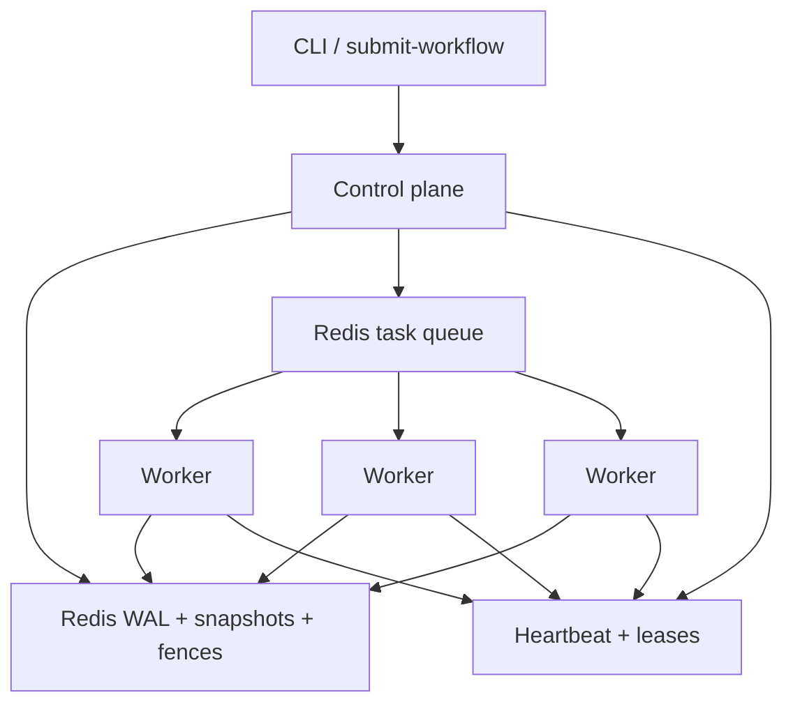

# Aether

**Fault-tolerant orchestration for multi-agent DAGs.** Workers can die mid-step; state cannot.

Aether runs agent workflows as a directed acyclic graph across a local Docker cluster. It is built for the failure mode that breaks most “just queue the LLM calls” systems: a worker disappears while holding a tool result, then comes back and tries to write it after the task has already been given to someone else.

```
Submit DAG  →  Control plane schedules ready tasks
            →  Workers claim with a fence token
            →  Results append to a Redis WAL
            →  Crash → snapshot + replay, never re-prompt
```

| Constraint | Choice |
| --- | --- |
| Budget | Local Docker only. No cloud, no LLM API spend. |
| Execution | At-least-once (retries after crash are required). |
| State | Fence-monotonic commits. Stale writers are rejected. |
| Recovery | Heartbeat every 500ms; worker declared dead after 3s. |
| Replay | Cached WAL outputs. Non-deterministic models are not re-invoked. |

---

## Why this exists

Agent graphs are not ordinary jobs. Steps are **non-deterministic**, context is **expensive to rebuild**, and a late write from a partitioned worker can silently corrupt the next prompt.

Aether treats that as a distributed-systems problem:

1. **Log first.** Every dispatch, claim, result, and reassignment is an append-only delta in Redis (`aether:wal:{workflow_id}`), with periodic snapshots.
2. **Fence every assignment.** Reassigning a task increments a per-task fence. The WAL refuses any commit whose token is behind the current value — the zombie-writer case.
3. **Fail cheaply.** The worker runtime talks to a deterministic mock agent (100–500ms synthetic latency). Chaos tests do not depend on OpenAI, GPUs, or a bill.

This is the same shape as production orchestrators (Temporal-style workflows, Kafka-style log + snapshot, Redlock-style short leases) cut down to a cluster you can `docker kill` on a laptop.

---

## Architecture



| Component | Role |
| --- | --- |
| **Scheduler** | Resolves the DAG, dispatches tasks whose dependencies are `COMPLETED`, requeues work owned by a dead worker. |
| **WAL** | Append-only deltas, snapshot, replay from `wal_index`. Source of truth after crash. |
| **Heartbeat monitor** | Redis hash + TTL leases. Missed liveness → `on_worker_failure`. |
| **Worker executor** | `BRPOP` the queue, `SET NX` a lock, refresh TTL while running, commit through the WAL, publish a wake-up. |
| **Mock agent** | Hash-seeded delay and JSON. Swap point for Ollama / vLLM later. |

Control plane and workers are separate processes (`python -m src.main control-plane` / `worker`). One Redis instance is the coordination fabric so the Compose file stays three services, not a message-bus zoo.

---

## Correctness model

Managers usually ask three questions. The answers are in the code, not the pitch.

**What happens if a worker is killed mid-task?**  
The lease expires (3s). The control plane bumps the fence, sets the task back to `PENDING`, deletes the lock, and enqueues it again. Remaining workers finish the DAG.

**What happens if the dead worker wakes up and writes?**  
`WriteAheadLog.append_delta` compares the commit’s `fence_token` to `aether:fence:{task_id}`. A higher fence → `StaleFenceError`. The late write never lands.

**Do we re-call the model on recovery?**  
No. `recover_latest_state` loads the latest snapshot and replays deltas. LLM/tool output is data in the log. Replay is deterministic even when the original step was not.

Honest scope: **execution is at-least-once**, **committed workflow state is fence-monotonic**. That is the useful guarantee for non-idempotent agent steps. Exactly-once *effects* on the outside world would need an idempotency key at the tool boundary; that is called out as future work, not pretended here.

Orphans are reclaimed too: a task that is `RUNNING` in the log but is neither waiting in the queue nor held by a live worker (for example, a worker died between `BRPOP` and taking the lock) is requeued after the same 3s bound. Tasks that are simply waiting behind a backlog are left alone.

Snapshots record exactly how many WAL entries they reflect, so a commit that lands while the control plane is checkpointing is replayed on the next recovery instead of being skipped.

---

## Design trade-offs

| Problem | What Aether does | What it does not do (yet) |
| --- | --- | --- |
| Split-brain control plane | Single leader. Simple, correct for a laptop cluster. | Raft / quorum. The TDD names it; v1 does not fake consensus. |
| Zombie workers | Monotonic fence tokens on the WAL. | Full Redlock across N Redis masters — one Redis, short NX locks. |
| Non-deterministic replay | Cache results in the log. | Prompting a real model during recover. |
| Queue vs bus | Redis list + pub/sub. Enough to demonstrate routing and wake-up. | NATS / RabbitMQ. Easy to swap the envelope, not the state machine. |
| Cost of testing failure | Mock backend + `docker kill`. | Staging spend or GPU nodes. |

The interesting code is the state machine, not the broker.

---

## 60-second run

Requires Docker. Python 3.9+ for tests (Compose images use 3.12).

```sh
python3 -m venv .venv && source .venv/bin/activate
pip install -r requirements.txt
PYTHONPATH=. pytest -q
```

```sh
docker compose up --build --scale worker=3 -d
docker compose run --rm control-plane python -m src.main submit-workflow sample_dag.json
docker compose logs -f control-plane worker
```

`sample_dag.json` is a four-node diamond: `ingest → {analyze, critique} → report`.

### Chaos

`chaos_dag.json` is 60 parallel shards plus a merge step, so the cluster is still busy when the kill lands.

```sh
docker compose up --build --scale worker=3 -d
docker compose run --rm control-plane python -m src.main submit-workflow chaos_dag.json
sleep 2 && docker kill "$(docker compose ps -q worker | head -n 1)"
docker compose logs control-plane | grep -E "worker.dead|task.reassigned|workflow.terminal"
```

You should see the worker marked dead about 3s after its last heartbeat, its in-flight task reassigned with a higher fence, and `workflow.terminal` with `"complete": true` once the survivors finish.

---

## Tests

```
tests/test_dag_resolution.py    ready-set, joins, cycles, missing edges
tests/test_chaos_recovery.py    WAL replay, stale fence reject, reassignment,
                                checkpoint/commit race, orphan vs. backlog
```

`pytest` uses `fakeredis` so CI does not need a live Redis. The Compose chaos path above is the integration check.

---

## Repository map

```
src/common/              Task/DAG models, structured logs, Redis client
src/control_plane/       scheduler, WAL, heartbeat
src/worker/              lock + fence executor, mock agent
src/main.py              control-plane | worker | submit-workflow
config/cluster.yaml      heartbeat / replica knobs
Dockerfile.control       control-plane image
Dockerfile.worker        worker image
```

---

## Deliberately not in v1

- Multi-control-plane Raft (availability of the *leader*, not of *tasks*)
- Real LLM providers in the default path
- Exactly-once side effects at external APIs
- Multi-tenant auth, TLS, or a public HTTP surface

Those are product layers. This repo is the recovery kernel: **log, fence, lease, requeue.**
