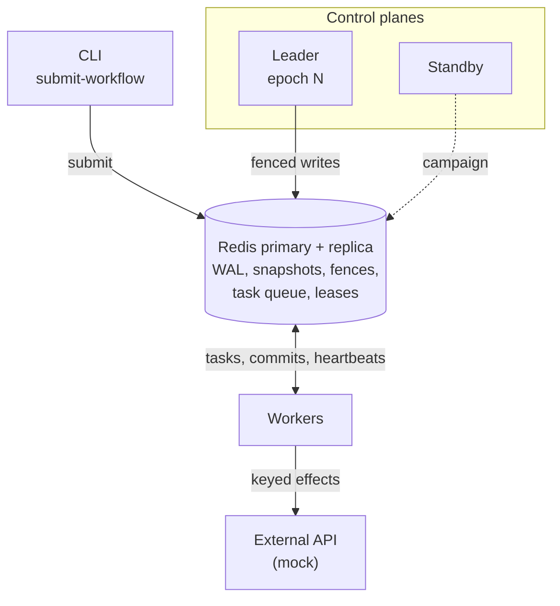

# Aether

[](https://github.com/andrey-tretyak/project-aether/actions/workflows/ci.yml)

**Fault-tolerant orchestration for multi-agent DAGs.** Workers and control planes can die, freeze, or come back from the dead mid-step; workflow state stays correct, and side effects happen once.

Agent workflows are a bad fit for "just queue the LLM calls": steps are non-deterministic, expensive to redo, and often touch the outside world. The failure that breaks naive systems is a worker that stalls while holding a result, gets replaced, then wakes up and writes anyway. Aether is a small, fully tested kernel for that problem: an append-only log, fence tokens, leases, and idempotency keys, running on Redis and Docker on a laptop.

## What it survives

CI injects each of these into real processes on every push, except two: the retry cap is a unit test, and the busy-worker numbers come from a lease benchmark ([details](docs/DESIGN.md#choosing-the-lease)).

| Failure | What Aether does | Result |
| --- | --- | --- |
| Worker killed mid-task | Lease expires; the task is requeued at the front of the queue under a new fence | Detected in 1.4–1.9s, finished elsewhere in ~2s |
| Worker frozen, then resumed after its task was reassigned | Its late commit carries a stale fence and is rejected | Rejected in every run; each task committed once |
| A retry repeats a side effect | Each effect carries an idempotency key that names the effect, not the attempt | 61 of 61 effects performed once; with keys off, the same run duplicates one |
| Worker alive but its event loop is blocked | Heartbeats come from a dedicated thread | 0 live workers declared dead in 5 runs, vs. 12 with in-loop heartbeats at the same lease |
| Worker shut down with `SIGTERM` | It drains: finishes its task, commits, deregisters | Nothing reassigned |
| Task keeps crashing its workers | Retry cap of 3, then `FAILED` with the reason in the log | The workflow fails cleanly instead of taking down worker after worker |
| Leader control plane killed | A hot standby wins the leader lease and replays state from the log | Took over in 1.5–2.5s |
| Leader frozen, then resumed | Leader writes are fenced by an election epoch; it steps down | No write from the old epoch after the takeover |
| All of the above at random | A seeded schedule kills, freezes, and drains workers and leaders mid-run; the log is audited afterwards | 20 of 20 seeds clean: 150 faults, 37 leader changes, 47 late writes rejected |
| Redis primary killed or frozen, or failed over to a replica that missed writes | Sentinel promotes the replica; a write counts only once the replica has it | 20 of 20 seeds clean through 30 Redis faults among 134. Without the fix, 8 of 20 failed: duplicate leader epochs, hung workflows, a commit under a lost fence |
| The whole stack in Docker | Same as above, through `docker compose` and `docker kill` | 97 tasks, one commit each, after a worker kill and a leader kill |

## Guarantees

- **Committed state is fence-monotonic.** A worker or leader that has been replaced cannot write, however late it wakes up.
- **Execution is at-least-once; external effects are exactly-once** wherever the receiving API honors idempotency keys. APIs that do not would need an outbox or reconciliation, which is not built here.
- **Recovery never re-prompts a model.** Results are data in the log, so replay is deterministic even when the original step was not.
- **With a Redis replica, acknowledged writes survive losing the primary.** A dispatch, claim, result, or election counts only once the replica has it ([how, and the limits](docs/DESIGN.md#losing-redis-replicas-and-failover)).

## Architecture



- **Log first.** Every dispatch, claim, result, and reassignment is an append-only delta in Redis. State is a snapshot plus the deltas after it; nothing else is authoritative.
- **Fence everything.** Each task has a monotonic fence, checked atomically with every commit. The leader is fenced the same way, by an election epoch checked in the same transaction as every control-plane write.
- **Lease liveness.** Workers renew a 1.5s lease from a dedicated thread; control planes compete for a 2s leader lease. Both lengths come from measurement, not guesswork.
- **Key the effects.** A side effect's idempotency key is derived from (workflow, task, effect index), so every retry and every zombie presents the same key.

Workers and control planes only talk to Redis, never to each other, so either side can fail without stalling the other. [docs/DESIGN.md](docs/DESIGN.md) covers each mechanism, the race conditions that shaped it, the lease benchmark, and the trade-offs.

## Run it

Tests need Python 3.9+; the containers use 3.12.

```sh
python3 -m venv .venv && source .venv/bin/activate
pip install -r requirements.txt
PYTHONPATH=. pytest -q
```

The cluster, with a standby control plane:

```sh
docker compose up --build -d --scale control-plane=2 --scale worker=3
docker compose run --rm control-plane python -m src.main submit-workflow sample_dag.json
docker compose logs -f control-plane worker
```

The chaos test runs real processes against a local Redis and injects one failure:

```sh
redis-server --daemonize yes
python scripts/chaos_test.py --kill-after 2
```

```
sent SIGKILL to worker-1 while it held step-19
PASS  61 tasks, 3 workers, completed in 8.45s, one commit per task, 1 re-executed, WAL audit clean
PASS  worker-1 detected dead 1.45s after SIGKILL (budget 2.5s)
PASS  its in-flight work finished on a survivor 1.80s after SIGKILL (budget 3.5s)
PASS  61 external effects, each performed exactly once; 0 repeated calls answered from the idempotency store
```

Swap the flag for `--pause-after 2` (zombie worker), `--stop-after 2` (drain), or `--control-planes 2 --kill-leader-after 3` / `--pause-leader-after 3` with `--dag failover_dag.json` (leader failover). [docs/DESIGN.md](docs/DESIGN.md#testing) lists every mode.

The randomized test mixes all of these on 3 control planes and 3 workers, restarting or resuming each victim after a random delay, then audits the write-ahead log for every guarantee above. The seed fixes the fault schedule; exact timings vary from run to run.

```sh
python scripts/nemesis.py --seed 107
```

```
seed 107: 9 faults injected, 0 skipped
  + 0.88s  drain worker-2 (holding chain-10-step-1)
  + 2.11s  freeze worker-3 (holding chain-06-step-2) for 0.8s
  + 3.74s  kill worker-3 (holding chain-04-step-3), replaced after 2.0s
  + 5.61s  freeze worker-1 (holding chain-01-step-4) for 1.5s
  + 7.23s  freeze control-plane-2 (epoch 1) for 3.8s
  + 8.06s  kill worker-4 (holding chain-09-step-5), replaced after 0.9s
  + 8.79s  kill worker-1 (idle), replaced after 1.1s
  +10.57s  kill worker-6 (holding chain-10-step-6), replaced after 2.0s
  +11.51s  freeze worker-7 (holding chain-09-step-6) for 3.2s
PASS  97 tasks completed in 16.31s; WAL audit of 307 entries found no violations (5 tasks re-executed)
      late writes rejected: 2 from zombie workers (fence), 1 from deposed leaders (leader check)
PASS  97 external effects, each performed exactly once; 2 repeated calls answered from the idempotency store
PASS  one leader per epoch: control-plane-2 (epoch 1) -> control-plane-3 (epoch 3)
PASS  6 workers declared dead, each while killed or frozen
PASS  no process crashed; 1 drained worker exited 0
```

`--redis-ha` runs Redis as a primary, a replica, and 3 Sentinels (it needs `redis-server` on the path) and adds Redis to the faults: kill or freeze the primary, freeze the replica, or cut the replica off and then kill the primary, so the failover loses writes.

```sh
python scripts/nemesis.py --redis-ha --seed 202
```

## Repository map

```
src/control_plane/    scheduler, write-ahead log, heartbeat monitor, leader election, log auditor
src/worker/           executor (locks, fences, drain), heartbeat thread, mock agent, keyed effects
src/common/           models, settings, structured logs, Redis clients
src/main.py           control-plane | worker | submit-workflow
config/cluster.yaml   leases, intervals, lock TTL, idempotency switch (AETHER_* overrides)
tests/                unit tests on fakeredis
scripts/              chaos test, randomized faults, local Redis + Sentinel topology,
                      Docker Compose smoke test, lease sweep
*_dag.json            sample (4 tasks), fan-out (61), and chained (97) workflows
docs/DESIGN.md        how and why
```

## Not in scope

- **Consensus-grade storage.** Sentinel plus replica-acknowledged writes survives losing the Redis primary, but it is not Raft: with several replicas Sentinel may promote one that missed a write, and nodes here run without persistence.
- **Real model providers in the default path.** The mock agent keeps failure testing free and deterministic; it is the swap point for Ollama or vLLM.
- **Exactly-once effects at APIs without idempotency keys.** That needs an outbox or reconciliation.
- **Multi-tenancy, auth, TLS, or a public API.** Product layers on top of this kernel.
